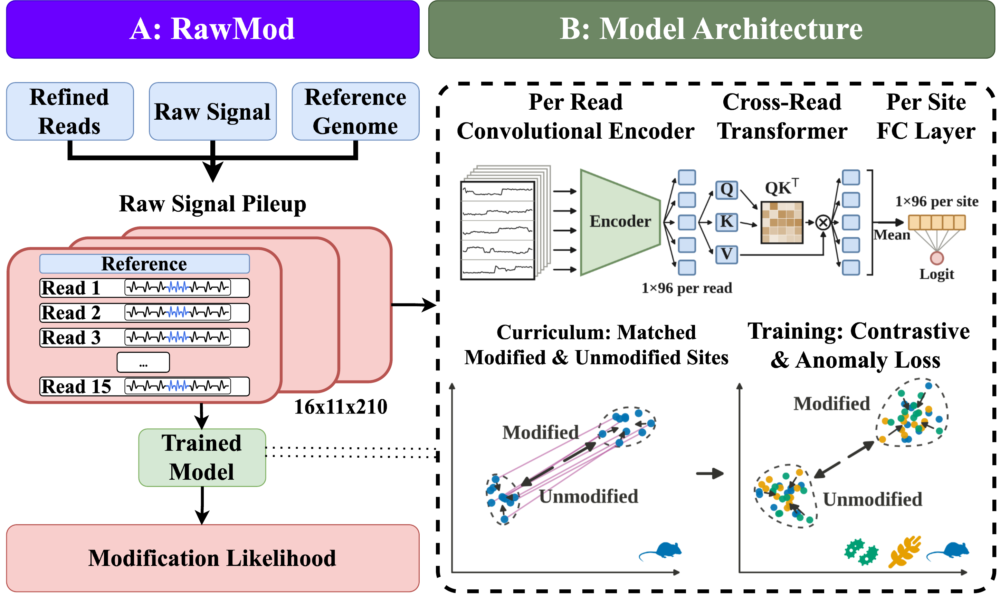

<p align="center" width="100%">
    
</p>

# RawMod Overview

RawMod detects modified DNA bases directly from raw nanopore signals. It is
**modification-agnostic**: one model detects 5-methylcytosine (5mC),
5-hydroxymethylcytosine (5hmC), N6-methyladenine (6mA), N4-methylcytosine (4mC)
and 5-hydroxymethyluracil (5hmU). It is **control-free**: it needs no unmodified
copy of the DNA.

RawMod answers one question per genomic position: *is this base modified?* It
gives each position a score between 0 and 1. It does not name the modification.

The figure above shows how RawMod works.

1. **Raw signal pileup (A).** For each queried position, RawMod collects the raw
   signal of up to 15 reads that cover it, over 21 bases centred on the
   position. A reference row on top holds the reference sequence and its
   expected signal. The pileup is a 16 × 11 × 210 tensor: 16 rows (reference and
   15 reads), 11 channels (signal, dwell time, base identity and others) and 210
   signal samples (10 per base).
2. **Model (B, top).** A convolutional encoder embeds each read. A transformer
   compares the reads with each other. A final layer gives one score per
   position. The model has 230,697 trainable parameters.
3. **Training (B, bottom).** RawMod is trained with classification, contrastive
   and anomaly-detection losses. A curriculum first trains on the same positions
   in a modified library and its unmodified control. The model therefore first
   learns the modification, not the sequence, organism or library.

RawMod works with R10.4.1 nanopore data sampled at 5 kHz. It reads POD5 files and
a reference genome. It can reuse existing Dorado basecalls if they carry move
tables.

# Contents

1. [Installation](#installation)
2. [Usage](#usage)
   1. [Choosing a workflow](#choosing-a-workflow)
   2. [Input files](#input-files)
   3. [Genome maps](#genome-maps)
   4. [Evaluation on sites with known modification status](#evaluation-on-sites-with-known-modification-status)
3. [Pretrained models](#pretrained-models)
4. [Training](#training)
5. [Reproducing the results](#reproducing-the-results)
6. [Site configuration](#site-configuration)
7. [Repository layout](#repository-layout)
8. [Citing RawMod](#citing-rawmod)
9. [License](#license)

# Installation

## Prerequisites

| Requirement | Version | Needed for |
|---|---|---|
| Python | 3.10 or later (we use 3.11) | everything |
| PyTorch | a CUDA 12.6 build, installed before RawMod (see [Quick start](#quick-start)) | scoring and training |
| NVIDIA GPU | optional | fast scoring and training; scoring also runs on CPU |
| [Dorado](https://github.com/nanoporetech/dorado) | 1.4.0, model `dna_r10.4.1_e8.2_400bps_sup@v5.0.0` | basecalling with move tables |
| [Remora](https://github.com/nanoporetech/remora) and [samtools](https://github.com/samtools/samtools) | Remora 3.3.0, samtools 1.16 or later | aligning the raw signal to reference bases |
| Linux, bash 4 or later | | the pipeline launchers (`scripts/genome_map/`, `scripts/train/`, `test/evaluation/`); see the note below |
| SLURM | optional | running the pipelines as cluster jobs |

Remora runs in its own Python environment. Remora 3.3.0 requires `numpy<2`, so installing it next to RawMod
silently downgrades numpy to 1.26. Keep the two environments separate. RawMod calls Remora through
`rawmod/extern/refine_moves_remora.py`. This script and the table of expected
signal levels (`uncalled_r1041_model_only_means.txt`) are included in
[`rawmod/extern/`](rawmod/extern/NOTICE.md). They need no separate installation.

## Quick start

* Clone the code from its GitHub repository:

```bash
git clone https://github.com/STORMgroup/RawMod.git
cd RawMod
```

* Install PyTorch first, then RawMod:

```bash
pip install torch --index-url https://download.pytorch.org/whl/cu126
pip install -e .
```

Without the first line, `pip` installs the newest PyTorch build, currently for CUDA 13. CUDA 13 builds have
no kernels for Pascal GPUs such as the GTX 1080 Ti, and scoring then fails with "no kernel image is
available". The CUDA 12.6 build runs on Pascal and on newer GPUs. The paper's results were produced with torch 2.12, and
torch 2.14.1 (CUDA 12.6) reproduces the benchmark. For a CPU-only machine, use
`--index-url https://download.pytorch.org/whl/cpu`.

* Check the installation:

```bash
rawmod-selftest
```

The self-test loads the released model (`checkpoints/rawmod.pt`) and scores two
synthetic pileups. It prints `OK`, the PyTorch version and the device it used. It
needs no reads, no Dorado and no GPU, and it takes a few seconds.

* Tell RawMod where Dorado and the Remora environment are:

```bash
mkdir -p ~/.config/rawmod
cp paths.env.example ~/.config/rawmod/paths.env
# edit ~/.config/rawmod/paths.env
```

See [Site configuration](#site-configuration) for details.

All commands below are run from the repository root (`RawMod/`).

The shell launchers need Linux with bash 4 or later. macOS ships bash 3.2: install a newer bash
(`brew install bash`) and run the launchers with it. The genome-map launchers stop with a message on older
versions.

`pip install -e ".[paper]"` adds the packages that some paper scripts need: UMAP
for Figure S2, and a ranged POD5 reader for the COLO829 walkthrough.

# Usage

## Choosing a workflow

| You have | You want | Workflow |
|---|---|---|
| Raw signal (`.pod5`) and a reference genome; optionally Dorado basecalls | Modification scores along a genome | [Genome maps](#genome-maps) |
| The same, plus positions whose modification status is known | Accuracy (AUROC, AUPRC, F1) on those positions | [Evaluation on sites with known modification status](#evaluation-on-sites-with-known-modification-status) |

No job scheduler is needed. Every pipeline runs on one machine by default. On a
SLURM cluster, the same pipelines submit their steps as jobs. Job resources come
from the [site configuration](#site-configuration), never from the scripts.

## Input files

| File | Content |
|---|---|
| `.pod5` | Raw nanopore signal (R10.4.1 flow cells, 5 kHz sampling). Required by every workflow. |
| Reference `.fasta` | Genome to which the reads are aligned. Contig names must match the BAM. |
| Basecalled BAM (optional) | Dorado output produced with `--emit-moves`. Aligned or unaligned. |
| `reads_refined.bam`, `peaks_refined.tsv` | Aligned reads and per-read signal boundaries after refinement. Produced by the preprocessing steps. |
| Site list (`.tsv`) | Positions to score: contig in column 1, position in column 2, tab-separated. A header line is optional. |
| Ground-truth BED | Positions known to be modified: contig and position, tab-separated, no header. |
| `features.h5` | Pileups in HDF5 format, one per scored position. Produced by `rawmod/featurization.py`. |

All positions are **0-based**: the first base of a contig is position 0.

## Genome maps

A genome map gives a RawMod score to every occurrence of one base along a genome,
for example every thymine for 5hmU. It can also score a list of positions that
you supply. No ground truth is needed.

### Step 1. Configure the site (once)

Copy `paths.env.example` to `~/.config/rawmod/paths.env`. Set the locations of
the Python environments and Dorado. On a cluster, also set the SLURM partitions.
Every later run reads this file. Without a scheduler, leave the SLURM settings
empty.

### Step 2. Run the pipeline

To score every thymine of a genome (5hmU), starting from raw signal, on this
machine:

```bash
bash scripts/genome_map/run_local.sh \
  --pod5 /path/to/pod5_dir \
  --ref  /path/to/genome.fasta \
  --out  /path/to/my_map
```

On a SLURM cluster, use `submit.sh` with the same options. It submits the steps
as a chain of jobs:

```bash
bash scripts/genome_map/submit.sh \
  --pod5 /path/to/pod5_dir \
  --ref  /path/to/genome.fasta \
  --out  /path/to/my_map
```

Add `--dry-run` to list the steps without running them. A genome-scale map takes
hours of GPU time, so use the scheduler where there is one.

If the reads are already basecalled with Dorado `--emit-moves`, add `--bam` to
skip basecalling. An unaligned BAM is aligned to the reference automatically.

```bash
bash scripts/genome_map/submit.sh \
  --pod5 /path/to/pod5_dir \
  --bam  /path/to/basecalls.bam \
  --ref  /path/to/genome.fasta \
  --out  /path/to/my_map
```

Basecalls without `--emit-moves` cannot be used. The move table links the raw
signal to individual bases. In that case, omit `--bam` and RawMod basecalls the
reads itself. The `.pod5` files are required in either case.

### Step 3. Select the positions to score (optional)

| Option | Effect |
|---|---|
| `--base T` | Score every position of this base. T (5hmU) is the default. Use A for 6mA and C for 5mC, 5hmC or 4mC. |
| `--sites my_sites.tsv` | Score only the listed positions (see below). |
| `--contigs chr1,chr2` | Score only these contigs. |
| `--strands "+ -"` | Score both strands. The default is the forward strand only. |
| `--checkpoint PATH` | Score with a different model. The default is `checkpoints/rawmod.pt`. |
| `--name NAME` | Prefix of the output files. The default is the name of the output directory. |

A site list has the contig in the first column and the 0-based position in the
second. An optional column named `strand` (`+` or `-`) assigns positions to
strands. Without it, all positions are on the forward strand. For example:

```
contig	pos	strand
chr1	1042	+
chr1	1187	+
chr1	2210	-
```

Each listed position must carry the selected base on its strand. On the forward
strand, the reference base must be the selected base (T for 5hmU). On the reverse
strand, it must be the complementary base (A for 5hmU). Other positions are
reported and skipped. Reverse-strand positions are scored only with
`--strands "+ -"`.

### Step 4. Collect the results

The pipeline writes to the output directory:

| Path | Content |
|---|---|
| `scores/<name>_mixed_strand+_scores.tsv.gz` | One row per position: `contig`, `pos`, `score` (0–1), `label` (always 0 here), `n_reads` |
| `genome_map.env` | The settings of the run |
| `logs/` | Logs of each step |
| `preprocess/` | Aligned and refined reads (reusable, see below) |

### Step 5. Draw the map

```bash
python scripts/genome_map/make_genome_map.py \
  --scores mixed=/path/to/my_map/scores/my_map_mixed_strand+_scores.tsv.gz \
  --gff annotations.gff3 \
  --window 10000 \
  --out /path/to/my_map/genome_map.png
```

The figure shows the mean score in consecutive windows along the contig against
the contig median. The window size is set by `--window` (default 10 kb). A gene
track is added if a GFF3 file is given, and read coverage is shown below. The
window values are also written to `genome_map.windows.tsv`.

### How to read a genome map

- **Compare regions, not single positions.** Where more than 15 reads cover a
  position, RawMod uses a random subset of 15. The score of one position
  therefore varies between runs. Window averages are stable.
- **Compare within a strand.** The two strands are scored on different scales.
  Compare each strand with its own median.
- **Treat scores as relative.** A score ranks positions by their evidence of
  modification. It is not the fraction of modified reads. Scores from different
  models are not on the same scale.

### Reusing earlier results

| Option | Effect |
|---|---|
| `--from featurize` | Reuse the reads in `preprocess/` from an earlier run, for example to score other positions. |
| `--from score` | Reuse the pileups from an earlier run, for example to score with another model. |
| `--until preprocess` | Stop once the reads are aligned and refined. |

The settings can also be kept in a configuration file
(`scripts/genome_map/config.example.env`) and passed as
`bash scripts/genome_map/submit.sh my_genome.env`. Command-line options take
precedence over the file.

## Evaluation on sites with known modification status

This workflow measures RawMod's accuracy on positions whose modification status
is known. The status can come from bisulfite or EM-seq data, or from a mutant
that lacks a methyltransferase.

**1. Prepare the reads.** If you do not have `reads_refined.bam` and
`peaks_refined.tsv`, produce them with the genome-map pipeline:

```bash
bash scripts/genome_map/run_local.sh --pod5 /path/to/pod5_dir --ref /path/to/genome.fasta \
  --out /path/to/my_sample --until preprocess
```

**2. Prepare two lists.** `sites.tsv` lists every position to evaluate, modified
and unmodified. It needs a header line:

```
contig	pos
chr1	1042
chr1	1187
chr1	1530
```

`gt.bed` lists the modified positions among them, without a header:

```
chr1	1042
chr1	1530
```

Positions in `sites.tsv` that are not in `gt.bed` count as unmodified. Only the
first two columns of `sites.tsv` are used.

**3. Score the sites.**

```bash
python scripts/evaluate/test_external_sites.py \
  --sites sites.tsv \
  --gt gt.bed \
  --pod5 /path/to/pod5_dir \
  --bam /path/to/my_sample/preprocess/reads_refined.bam \
  --peaks /path/to/my_sample/preprocess/peaks_refined.tsv \
  --level-table rawmod/extern/uncalled_r1041_model_only_means.txt \
  --checkpoint checkpoints/rawmod.pt \
  --strand + --normalize \
  --out-dir results/my_sample
```

| Output | Content |
|---|---|
| `scores.tsv` | One row per position: `contig`, `pos`, `score`, `label` |
| `metrics.tsv` | AUROC, AUPRC, F1, precision and recall over all positions |
| `features.h5` | The scored pileups; pass `--skip-featurize` to score them again |

Requirements:

- **Normalization.** Always pass `--normalize`. The models were trained on
  MAD-normalized signal.
- **One strand per run.** For `--strand +`, list positions whose reference base
  is the modified base (C for 5mC, A for 6mA, T for 5hmU). For `--strand -`, list
  positions whose reference base is its complement (G, T and A).
- **Coverage.** Positions with fewer than `--min-reads` reads (default 12) are
  skipped. Lower this value for low-coverage data.
- **Both classes.** The list must contain modified and unmodified positions.
  Otherwise AUROC is not defined.

An existing `features.h5` can be scored directly:

```bash
python scripts/evaluate/score_genome.py --h5 features.h5 --dataset my_sample \
  --checkpoint checkpoints/rawmod.pt --out-dir results/my_sample
```

**Motif-defined ground truth.** RawMod sees the reference sequence. Suppose the
ground truth is defined by a sequence motif, for example every GATC site. Then the
sequence alone predicts the label, and AUROC does not measure modification
detection. In that case, compare RawMod with a sequence-only baseline, or compare
a modified and an unmodified sample at the same positions.

# Pretrained models

All models share one architecture (230,697 trainable parameters) and one training
recipe (see [Training](#training)). They differ only in what was held out of
training. [`checkpoints/README.md`](checkpoints/README.md) describes every file.

| Checkpoint | Trained on | Use |
|---|---|---|
| `checkpoints/rawmod.pt` | All data | **Scoring new data.** The default of every workflow. |
| `checkpoints/region_holdout/mixed.pt` | All data except one contiguous ~15% region of every genome, and every read that overlaps it | Accuracy numbers of the paper (Tables 1 and 2), measured inside the withheld regions |
| `checkpoints/region_holdout/loco_<mod>.pt` | As `mixed.pt`, and without every organism that carries `<mod>` | Detection of a modification type never seen in training (Table 2) |
| `checkpoints/leaveout/<name>.pt` | As `mixed.pt`, and without every sample of one organism or library | Supplementary leave-out table of the benchmark (`test/`) |

Accuracy of the region-holdout models inside the withheld regions
(`checkpoints/region_holdout/metrics.tsv`, one training seed; the paper reports
the mean over three seeds):

| Model | Withheld modification | AUROC | AUPRC | Modified / scored positions |
|---|---|---:|---:|---:|
| `mixed.pt` | none | 0.987 | 0.958 | 12,927 / 55,845 |
| `loco_5mC.pt` | 5mC | 0.977 | 0.733 | 78 / 3,456 |
| `loco_5hmC.pt` | 5hmC | 0.973 | 0.565 | 40 / 3,418 |
| `loco_6mA.pt` | 6mA | 0.640 | 0.319 | 6,274 / 30,240 |
| `loco_4mC.pt` | 4mC | 0.914 | 0.492 | 551 / 13,343 |
| `loco_5hmU.pt` | 5hmU | 0.470 | 0.663 | 3,570 / 5,298 |

A withheld modification is detected when another modification of the same base
stays in training (5mC, 5hmC and 4mC are all cytosine modifications). 6mA and
5hmU are the only modifications of their base in the training data, and they are
not detected when withheld.

The released model `rawmod.pt` has seen every region of every training genome.
It therefore cannot be evaluated on them. Its accuracy on new data is expected to
match `mixed.pt`.

# Training

`scripts/train/run_matched_loco.sh` reproduces the released models. It trains the
mixed model and the five models that each withhold one modification. They run one
after another on this machine, or as separate jobs on a cluster:

```bash
cd scripts/train
RAWMOD_STRANDRES_ROOT=/path/to/features \
RAWMOD_DATA_GEN=strandres EXTRA_ORGANISMS=1 INCLUDE_HUMAN=1 \
TF_LAYERS=2 EXCLUDE_UNTYPED_POS=1 CURRICULUM=1 \
POS_BASE_CAP_RATIO=4 POS_DROP_BASES=T \
CTRL_TARGET_BASE_TO_TEST=orphan NEG_CAP_SPO1=200000 \
PILEUP_MASK_BASES=0 BCE_WEIGHT=1.0 \
SUPCON_WEIGHT=1.0 SUPCON_DIM=128 SUPCON_TEMP=0.20 \
SAD_DIM=16 SAD_LOSS=hinge SAD_MARGIN=2.0 SAD_WEIGHT=1.0 SAD_ETA=1.0 \
RAWMOD_AMP=1 \
OUTDIR=/path/to/output \
bash run_matched_loco.sh --seed 42
```

The losses are binary cross-entropy (`BCE_*`), supervised contrastive learning
(`SUPCON_*`, weight 1.0, temperature 0.20) and Deep SAD anomaly detection with a
hinge loss (`SAD_*`, 16 dimensions). `CURRICULUM=1` turns on the curriculum. `RAWMOD_AMP=1` trains
in bfloat16 mixed precision, as the released models were; it needs an Ampere or newer GPU.

* `--dry-run` prints the job submissions without running them.
* `FOLDS` selects a subset of models, for example `FOLDS="mixed loco_6mA"`.
* Each model is written to `models/<fold>/<fold>/best_model.pt`. Test metrics go
  to `metrics/<fold>.tsv` and per-site test scores to `scores/`.
* `rawmod-visualize <run directory>` draws the training curves,
  precision-recall curves and confusion matrices of a run, and writes its metrics
  table.

Training features are built from the ground-truth data by
`scripts/featurize/refeaturize_strand_resolved.py`. It builds one pileup per
position and strand. `scripts/ground_truth/split_gt_by_strand.py` splits
ground-truth BED files by strand.

# Reproducing the results

| Result | Where |
|---|---|
| Table 1, Figure 3 and the supplementary benchmark tables: RawMod against Dorado, UniMeth, DeepMod2, Rockfish, MethyNano, Uncalled4 and NovaMod on 15 ground-truth rows | [`test/`](test/README.md): download scripts, the fixed read sets and ground-truth positions, and the scripts that run every tool |
| Every other table and figure: generalization, few-shot, ablations, embeddings, the dinoflagellate map, read-origin typing | [`paper/`](paper/README.md): one directory per result, with the scripts that produced it and the inputs they need |

The numbers behind every figure and table are in `paper/data/`. The figure and
table scripts therefore run on a fresh clone. For example, Table 2:

```bash
python paper/table2_fig4_generalization/make_region_figures.py table
```

`paper/README.md` states which inputs each analysis script needs.

# Site configuration

No machine-specific path is stored in this repository. Scripts read locations
from environment variables, or from `~/.config/rawmod/paths.env`. Set
`RAWMOD_PATHS_FILE` to use another file. `paths.env.example` lists every
variable. Only the variables of the workflow you run need to be set.

# Repository layout

| Path | Content |
|---|---|
| `rawmod/` | The Python package: pileup construction (`featurization.py`, `featurize_fast.py`), the model, dataset and losses (`model.py`), the self-test, and the included signal-refinement script and level table (`extern/`) |
| `checkpoints/` | The released model and the evaluation models ([Pretrained models](#pretrained-models)) |
| `scripts/genome_map/` | Score every position of a genome from raw signal (`run_local.sh` for one machine, `submit.sh` for SLURM) |
| `scripts/evaluate/` | Score positions with known modification status; score inside the withheld regions; `visualize_pileup.py` draws one pileup |
| `scripts/train/` | Train the released and evaluation models |
| `scripts/featurize/`, `scripts/ground_truth/` | Build training features and ground-truth position sets |
| `test/` | The tool benchmark (Table 1) |
| `paper/` | The scripts behind the other results of the paper, and the numbers they plot (`paper/data/`) |
| `gitfigures/` | Figures of this README |

# Citing RawMod

The RawMod paper is under review. We will add its citation here once it is
published. Until then, please cite this repository:
https://github.com/STORMgroup/RawMod.

# License

RawMod is released under the GNU General Public License v3.0 ([LICENSE](LICENSE)).
The third-party files in `rawmod/extern/` keep their own licenses
([NOTICE](rawmod/extern/NOTICE.md)).

Please report problems and questions as
[GitHub issues](https://github.com/STORMgroup/RawMod/issues).
